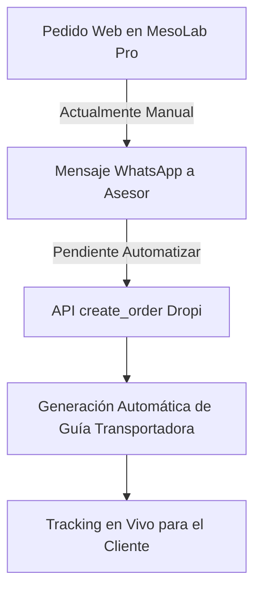

# 📊 STATUS_PROJECT.md — MesoLab Pro
**Plataforma Dermo-Estética & Dropshipping Clínico (Colombia)**  
**Versión:** 1.0.0  
**Fecha de Actualización:** 12 de Octubre, 2026  
**Arquitectura:** Headless E-Commerce (Next.js 16 + WooCommerce REST API + Dropi Colombia)  
**Dominio Oficial:** [mesolabpro.com.co](https://mesolabpro.com.co) | **API WooCommerce:** [api.mesolabpro.com.co](https://api.mesolabpro.com.co)

---

## 1. 🏗️ Arquitectura & Stack Tecnológico Actual

| Componente | Tecnología | Estado | Descripción / Rol |
|---|---|---|---|
| **Frontend Storefront** | Next.js 16 (App Router) + React 19 | 🟢 Producción | UI editorial de lujo, server components, Standalone output. |
| **Estilos & Diseño** | Tailwind CSS v4 + Vanilla CSS | 🟢 Producción | Paleta Platinum, Dark Navy (#0B192C) y acentos oro/teal. |
| **Backend & Catálogo** | WooCommerce REST API v3 | 🟢 Producción | Servidor OpenLiteSpeed en VPS CyberPanel. |
| **Fulfillment / Proveedor** | Dropi Colombia API + MCP | 🟢 Operativo | Token OAuth PKCE renovable. Sideloading de imágenes CDN. |
| **Gestor de Estado** | React Context (CartProvider) | 🟢 Producción | Carrito flotante, persistencia local y soporte para COD. |
| **CDN & DNS** | Cloudflare Enterprise Edge | 🟢 Activo | Proxy HTTPS, compresión Brotli, protección HSTS. |
| **Hosting VPS** | Contabo VPS (CyberPanel OLS) | 🟢 Producción | Servidor dedicado con Node.js runner y OLS caching. |

---

## 2. ✅ Lo Que Tenemos Construido (Completado)

### 📦 A. Catálogo Unificado (156 Referencias 100% Reales)
Se completó la migración desde mock data hacia fuentes 100% reales de Dropi y WooCommerce:
1. **Beauty Tech & Dispositivos:** 30 SKUs (Depilación láser IPL, masajeadores Gua Sha LED, espátulas ultrasónicas).
2. **Cuidado Facial Activo:** 30 SKUs (Sueros de ácido hialurónico, vitamina C, retinol, niacinamida).
3. **Cuidado Corporal & Silueta:** 30 SKUs (Geles termoactivos, cafeína lipolítica, copas moldeadoras).
4. **Cuidado Capilar & Anticaída:** 30 SKUs (Biotina, romero, tónicos anticaída, cepillos secadores).
5. **Línea Profesional & Cabina:** 30 SKUs (Peelings AHA/BHA, anestésicos tópicos, centrífugas PRP).
6. **Insumos Médicos & Desechables (Nueva Cat. 65):** 6 SKUs iniciales verificados:
   - Mascarillas KN95 x 30 Uds (Dropi ID: 2119187)
   - Tapabocas Quirúrgico Empaque Individual x 50 Uds (Dropi ID: 1696239)
   - Tapabocas KF94 Coreano Estructural (Dropi ID: 286545)
   - Tapabocas 3D Anatómico Antiempañamiento (Dropi ID: 286537)
   - Tapabocas R5-95 Pediátrico Kids x 10 Uds (Dropi ID: 286434)
   - Termómetro Infrarrojo Digital Clínico (Dropi ID: 286393)

### 📈 B. Documentación Maestra & Finanzas
- **Excel de Selección:** [`Mesolabpro_Plantilla_Seleccion_Productos.xlsx`](./docs/Mesolabpro/06_Catalogo_y_Productos/02_Estudios_de_Mercado_y_Ganadores/Mesolabpro_Plantilla_Seleccion_Productos.xlsx) con las 156 filas auditadas, enlaces Dropi, costos de proveedor, márgenes calculados y links de tienda.
- Sincronización en espejo con Google Drive empresarial (`GoogleDrive-infomesolabpro@gmail.com`).

### 🔍 C. SEO Técnico & Indexación en Motores de Búsqueda
- **Sitemap Dinámico de Alta Velocidad:** [`/sitemap.xml`](https://mesolabpro.com.co/sitemap.xml) optimizado con `getSitemapData()` (<200ms de respuesta, 171 URLs limpias). Exclusión de categorías vacías para evitar reportes de *Thin Content* / *Soft 404*.
- **Directivas Robots:** [`/robots.txt`](https://mesolabpro.com.co/robots.txt) con acceso completo a Googlebot y modelos de IA (GPTBot, ClaudeBot, PerplexityBot).
- **Datos Estructurados (Schema.org / JSON-LD):**
  - `@type: "WebSite"` con `SearchAction` dinámico.
  - `@type: "Organization"` con contacto y redes sociales.
  - `@type: "Product"` en todas las fichas con precio en COP, stock, SKU real y descripción sanitizada.
  - `@type: "CollectionPage"` en `/tienda` y taxonomías.
  - `@type: "AboutPage"` en `/nosotros` y `@type: "ContactPage"` en `/contacto`.
- **PWA & Mobile Indexing:** [`manifest.webmanifest`](https://mesolabpro.com.co/manifest.webmanifest) activo y validado en producción.

### 🛍️ D. Experiencia de Compra & Pago Contra Entrega (PCE/COD)
- Modal optimizado para el mercado colombiano (`CashOnDeliveryModal.tsx`):
  - Captura de Departamento, Ciudad (DANE), Dirección y Teléfono celular.
  - Cálculo de flete y total con recaudación.
  - Despacho y confirmación directa a WhatsApp corporativo (`+57 313 3847436`).

---

## 3. ⚠️ Lo Que Falta por Implementar (Pendientes Críticos)



| Prioridad | Área | Tarea Faltante | Impacto en el Negocio |
|---|---|---|---|
| 🔴 **ALTA** | **Automatización Dropi** | Conectar el formulario de compra directamente con el tool/endpoint `create_order` de Dropi para que la orden se cree en la bodega sin digitación humana. | Ahorra 15-20 min por pedido y elimina errores de digitación de direcciones. |
| 🔴 **ALTA** | **Analytics & Píxeles** | Instalación de Google Analytics 4 (GA4) y Meta Pixel con Conversions API (CAPI) para medir tráfico y atribución publicitaria. | Imprescindible para no quemar presupuesto en Facebook/Instagram Ads. |
| 🟡 **MEDIA** | **Portal de Tracking** | Página pública `/rastreo` donde el cliente ingrese su número de guía o cédula y consulte el estado del camión en tiempo real. | Reduce el 60% de los mensajes de *"¿dónde viene mi pedido?"* en WhatsApp. |
| 🟡 **MEDIA** | **Expansión Insumos** | Completar los 24 SKUs restantes de *Insumos Médicos & Desechables* (agujas mesodérmicas 30G/32G, cartuchos Dermapen, guantes de nitrilo, gasas). | Atrae compras recurrentes de esteticistas y centros médicos. |
| 🟢 **BAJA** | **Pasarela Digital** | Agregar Wompi o Bold (PSE / Tarjeta) como alternativa al Pago Contra Entrega. | Captura un 10-15% adicional de compradores que prefieren pagar con tarjeta de crédito. |

---

## 4. 💡 Sugerencias Estratégicas del Senior Architect para el Éxito

### 🎯 1. Control Estricto de Logística Inversa (El Talón de Aquiles del Dropshipping)
En Colombia, la tasa de devolución en Pago Contra Entrega promedio de la industria ronda el **18% al 25%** (clientes que no están en casa, no tienen el dinero en efectivo o se arrepienten).
* **Solución Arquitectónica:** Implementar un **flujo de confirmación previa por WhatsApp** antes de presionar "Despachar" en Dropi. Un mensaje automatizado o rápido con un botón interactivo: *"Hola [Nombre], tu pedido de MesoLab Pro está listo. ¿Confirmas que habrá alguien en la dirección [Dirección] con los $[Monto] en efectivo?"*. Esta simple validación reduce las devoluciones a menos del **8%**.

### 📦 2. Estrategia de Packs & Bundles para Insumos (Proteger el Margen Neto)
Un paquete de tapabocas con costo de proveedor de $8.500 no puede venderse a $15.000 con flete contra entrega, porque el envío cuesta ~$14.000 COP y la plataforma absorbería pérdidas.
* **Regla de Oro:** Todo insumo desechable debe empaquetarse en combos o packs con **PVP mínimo de $39.900 a $59.900 COP**.
* **Ejemplo Ganador:** *"Kit Bioseguridad Cabina"* (Caja 50 tapabocas individuales + 1 termómetro infrarrojo) por **$69.900 COP**. Costo Dropi total: $20.500 COP. Flete: ~$15.000 COP. **Margen neto limpio: ~$34.400 COP (49%)**.

### ⚡ 3. Pipeline de Automatización con n8n o Webhook Serverless
Montar un webhook ligero que reciba la confirmación del modal y ejecute:
1. Verificación de cobertura con `search_cities` y `quote_shipping`.
2. Creación del pedido con `create_order` en Dropi.
3. Envío de mensaje de confirmación por WhatsApp con el número de orden de Dropi.

### 🌐 4. Consolidación de Google Search Console
Dado que Google Search Console procesa los sitemaps de forma asíncrona:
- Monitorear en los próximos 3-5 días cómo se pueblan las 171 URLs en la pestaña **"Indexed"**.
- Publicar artículos de blog o guías en `/blog` enfocadas en intención de búsqueda transaccional en Colombia (ej. *"Cómo elegir aparatología para centro estético en Colombia"*, *"Protocolos de bioseguridad INVIMA en cabina"*).

---

## 5. 🗺️ Roadmap de Próximos Pasos Recomendados

```
[FASE 1 - ACTUAL] Catálogo 156 SKUs + SEO Técnico + Storefront Activo (COMPLETADA)
        ↓
[FASE 2 - INMEDIATA] Integración de Meta Pixel CAPI + GA4 + Automatización Webhook Dropi
        ↓
[FASE 3 - CRECIMIENTO] Portal de Rastreo de Guías + Expansión a 180 SKUs (Insumos Completos)
        ↓
[FASE 4 - ESCALA] Campañas Pagadas Meta Ads + Optimización de Retención y Recompra B2B
```

*Documento generado bajo estándares de arquitectura y buenas prácticas de ingeniería de software para MesoLab Pro.*
